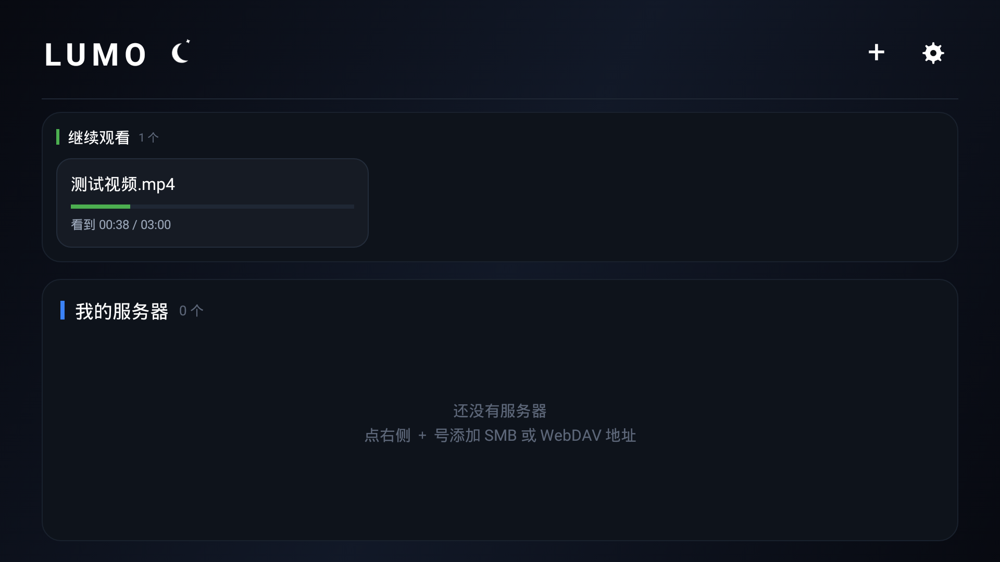

# Lumo · 老电视上的家庭影音中心

把一台 2014 年的乐视电视（Android 4.3，32 位 ARM）重新用起来：直连 NAS / Mac / Windows 的
SMB 共享，插 U 盘直接放，七种播放引擎按机器能力自动挑选。

> **English**: Lumo is a minimal Android media player built for old ARMv7 TVs (Android 4.3+).
> It speaks SMB2/SMB3 (own pure-Java implementation), SMB1 and WebDAV, plays from USB storage,
> and switches between ijkplayer / system MediaCodec engines. MIT licensed.



---

## 为什么会有这个项目

乐视 X50 Air 的硬件其实还行（4 核 A9 + 2GB 内存），但它自带的系统只有 Android 4.3、
自带的播放器连局域网共享都不支持。市面上现成的播放器要么最低要求 Android 5.0，
要么装上去之后遥控器焦点乱飞、手机端触摸又完全没有控件。

所以这个项目的目标很具体：**在 4.3 的电视上，遥控器和手指都能舒服地用**。

- 界面按 10 英尺距离重做：大字号、清晰焦点框、方向键走位；
- 手机装同一个 APK：自动切成紧凑布局 + 全手势操作（左右滑动调进度、右侧上下滑调音量、
  左侧上下滑调亮度、长按加速、双击暂停）；
- **播放中没有任何弹窗和 Toast**，所有反馈走顶部 HUD，不打断画面。

| 浅色（白天）主题 | 局域网扫描 |
|---|---|
|  |  |

| 设置与诊断 | 浅色下的文件浏览 |
|---|---|
|  |  |


---

## 功能

**连接**

- SMB2 / SMB3（自研纯 Java 客户端，支持 NTLMv2、HMAC-SHA256 与 AES-CMAC 报文签名）
- SMB1 / CIFS（jcifs，只为十几年没升级的老 NAS 留着）
- WebDAV（含 Basic 认证、自签证书）
- U 盘 / SD 卡：插上才显示，拔掉自动消失
- 服务器地址保存在主界面卡片上，点一下就连；长按可编辑 / 删除
- 每台服务器可以起名字（如「客厅 NAS」），卡片上直接显示名字
- 「启动自动连接」可选，只在进程第一次进主界面时触发
- **扫描局域网**：自动找同网段开 445 端口的机器，点一下就把 IP 填进地址框
- 连接过程分阶段显示（连接端口 → 协商 → 认证 → 挂载共享），30 秒封顶，
  失败时直接说清卡在哪一步

**播放**

- 5 种引擎：ijkplayer 硬解 / ijkplayer 软解 / ijkplayer 软解 RGB32 / 系统解码 + SurfaceView /
  系统解码 + VideoView（4K 老电视默认，最省）
- 引擎出错自动往下一个降级，崩溃后重启也会自动换引擎（自愈）
- 设置里能直接看到**本机解码能力自检**（H.264 / H.265 有没有硬解、最大分辨率）
- 片头 / 片尾一键跳过（同一个面板里设置）
- 记忆播放进度、字幕（srt/ass/ssa/vtt，UTF-8 与 GBK 自动识别）、音轨切换、
  画面比例（适应屏幕 / 16:9 / 4:3 / 原始像素，都不裁切不拉伸）、旋转、连续播放同目录下一集

**操控**

- 遥控器：左右 5 秒快进快退（长按连续跳）、上下切集、OK 呼出控制条
- 控制条按钮长按 = 弹出全部选项（速度 / 比例 / 引擎）
- 手机：左右滑动调进度、右侧上下滑调音量、左侧上下滑调亮度、长按 2/3/4 倍速、双击暂停
- 诊断面板：内建日志、崩溃现场（含 native 信号）、当前协议与引擎
- **两套主题**：深色影院（默认）/ 浅色白天，顶栏一键切换并记忆；
  颜色走 `values` + `values-night` 两套资源，切换只重建界面，不重写控件代码

---

## 支持的设备

| 项目 | 要求 |
|---|---|
| 系统 | Android 4.3 (API 18) 及以上，minSdk 17 |
| CPU | ARM 32 位（armeabi-v7a） |
| 分辨率 | 1280×720 起，TV 布局在 `w720dp` 生效 |
| 实测 | 乐视 X50 Air（Android 4.3）、Android 5.0 / 7 / 9 手机模拟器 |

> 打包只带 `armeabi-v7a`，APK 19MB。想在 arm64 设备上调试，把 `app/build.gradle`
> 里的 `abiFilters` 改成 `arm64-v8a`（此时 ijkplayer 不可用，其它引擎正常）。

---

## 安装

1. 到 [Releases](../../releases) 下载 `Lumo-vX.XX.apk`（或本地 `dist/` 目录）；
2. 拷到 U 盘插电视，用电视的文件管理器点开安装；
3. 或 `adb install -r Lumo-v1.33.apk`。

首次打开只会看到「＋」号：点它添加服务器。

### 连 Mac（macOS 13 及以上）

系统设置 → 通用 → 共享 → **文件共享** 打开 → 选项 里勾选你的账号 → 记下共享名
（默认是你的用户名，也可以自己加一个文件夹并指定名字）。

在 Lumo 里填：

```
地址：192.168.1.10        （建议填 IP，别填机器名）
共享：你的共享名
用户：你的 macOS 登录名   （不要写 xxx@MacBook.local）
密码：登录密码
```

macOS 13 起系统共享**已经彻底移除了 SMB1**，所以只能用 SMB2/3 —— 这正是本项目
自带 SMB2 客户端的原因（见 [docs/SMB2.md](docs/SMB2.md)）。

### 连 Windows

Win10/11 默认关闭 SMB1，同样走 SMB2；共享名就是右键文件夹 → 属性 → 共享 里显示的名字。
如果账号带微软账户，用户名填 `MicrosoftAccount\你的邮箱` 或直接用本地账户。

### 老 NAS 连不上

设置 → **SMB 协议** 里从「自动」切成「只用 SMB1」，再试一次。这个开关就是给
群晖 DSM 4.x、老路由器的 samba 之类准备的。

---

## 从源码构建

需要 JDK 17、Android SDK（compileSdk 34）。

```bash
git clone <this repo> && cd Lumo

# 1) 告诉 Gradle SDK 在哪
echo "sdk.dir=$HOME/Library/Android/sdk" > local.properties     # macOS
# echo "sdk.dir=$HOME/Android/Sdk" > local.properties           # Linux

# 2) 生成自己的签名（不签也能编译，只是装不上/覆盖不了）
keytool -genkeypair -v -keystore letvcast.keystore -alias letvcast \
        -keyalg RSA -keysize 2048 -validity 10000
cp keystore.properties.example keystore.properties   # 填密码

# 3) 出包
./gradlew assembleRelease
# 产物：app/build/outputs/apk/release/app-release.apk
```

细节（含 `zipalign` / `apksigner` 手动签名、arm64 调试包）见 [docs/BUILD.md](docs/BUILD.md)。

---

## 目录结构

```
Lumo/
├── app/src/main/
│   ├── java/com/letvcast/player/
│   │   ├── MainActivity.java        主界面：服务器卡片、U 盘、设置与诊断
│   │   ├── BrowseActivity.java      文件浏览（SMB / WebDAV / 本地 三种模式）
│   │   ├── PlayerActivity.java      播放器：7 引擎、手势、HUD、字幕、片头片尾
│   │   ├── Smb2Client.java          ★ 自研 SMB2/SMB3 客户端（NTLMv2 + 报文签名）
│   │   ├── SmbClient.java           SMB 门面：SMB2 优先，必要时退回 SMB1
│   │   ├── SmbStreamProxy.java      把 SMB 文件桥接成本地 HTTP（支持 Range）
│   │   ├── SmbHandle.java / Smb1Handle.java   统一文件句柄
│   │   ├── WebDavClient.java / WebDavStreamProxy.java
│   │   ├── UsbStorage.java / LocalClient.java  U 盘与本地文件
│   │   ├── Theme.java / ThemeIcon.java   深/浅主题与图标
│   │   ├── LanScan.java             局域网扫描（找 445）
│   │   ├── CodecInfo.java           解码能力自检
│   │   ├── Config.java / Ui.java / LogBus.java / App.java
│   ├── res/layout/                  手机布局
│   ├── res/layout-w720dp/           TV 布局（同名字覆盖，10 英尺 UI）
│   ├── jniLibs/armeabi-v7a/         ijkplayer 与崩溃捕获 .so
│   └── cpp/crashcatch.c             sigaction 抓 native 崩溃
├── docs/SMB2.md                     SMB2 客户端实现笔记
├── docs/BUILD.md                    构建与签名细节
└── screenshots/
```

---

## 几个值得说的实现点

**1. 自研 SMB2/SMB3 客户端（`Smb2Client.java`，无第三方依赖）**

jcifs 1.3.x 只会 SMB1，而 macOS 13 和 Win10+ 都不再提供 SMB1 服务端，
所以「连不上 Mac」的根因不是账号密码，而是协议。这里按 MS-SMB2 自己实现了
NEGOTIATE / SESSION_SETUP(NTLMv2) / TREE_CONNECT / CREATE / QUERY_DIRECTORY / READ / CLOSE，
签名同时支持 SMB2.1 的 HMAC-SHA256 与 SMB3 的 AES-CMAC（含 SP800-108 KDF）。
连到 SMB3 但签名被拒时会自动降级到 2.1 重试，不把问题丢给用户。

**2. 播放中零打扰**

Toast 全部换成顶部 HUD，播放时不黑屏、不弹窗、不打断声音。诊断日志写进私有目录，
电视上没有 adb 也能在设置里直接看崩溃现场。

**3. 老机器上的韧性**

播放器崩了会被 `App` 记下来，下次启动自动换下一个引擎；SMB 会话断了（NAS 休眠）
会自动重连一次；主线程永远不碰网络，退出播放器时先断 socket 再释放播放器，
避免老系统上 `MediaPlayer.release()` 卡死输入（这个坑踩过，见 CHANGELOG 1.33）。

---

## 常见问题

**Q：能放 H.265 / 4K 吗？**
设置 → 本机解码能力 会直接告诉你这台的硬解档位。1080p H.265 通常能硬解；
4K H.265 在 2014 年的芯片上无解，软解也带不动，换片源或用盒子。

**Q：拖进度条会卡一下？**
SMB 走的是本地 HTTP 代理 + Range 请求，拖动就是一次 seek，局域网千兆下几乎无感；
无线 2.4G 大码率片子会慢半拍，属正常。

**Q：主题在哪切？**
顶栏最右边：深色时显示月亮、浅色时显示太阳，点一下立刻切换并记住。

**Q：为什么没有海报墙 / 刮削？**
刻意不做。老电视 CPU 弱，扫库会卡；这个项目的定位是「打开就能放」。

---

## 协议

代码：MIT（见 [LICENSE](LICENSE)）。
三方组件及其许可证（ijkplayer / jcifs 均为 LGPL 系）见 [THIRD_PARTY.md](THIRD_PARTY.md)。
如果要发布到应用商店，请先自行确认 LGPL 组件的合规方式。
